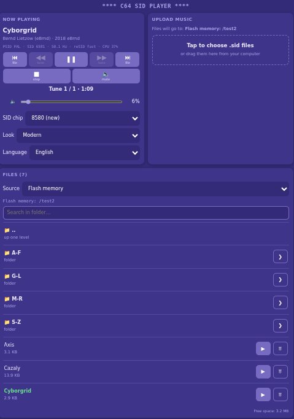

# C64SidPlayer – Commodore 64 SID music player for ESP32

*[Wersja polska poniżej](#c64sidplayer--odtwarzacz-muzyki-sid-z-c64-dla-esp32)*

A Commodore 64 music player (`.sid` files, PSID and RSID formats) for ESP32 and ESP32-S3.
The firmware emulates the 6510 CPU and runs the original player code from the file, just like
a real C64 does. The sound is produced by an emulated SID chip (6581 / 8580) or by a **real
SID chip** connected to the ESP32.

## Features

- PSID and RSID files, all subtunes, PAL / NTSC, raster and CIA timer speed (also multispeed).
- Three SID engines selected at build time: reSID 0.16 (accurate), a lightweight built-in engine,
  or a real MOS 6581 / 8580 chip.
- Audio output through an external I2S DAC (PCM5102A, UDA1334A, MAX98357A) or the internal 8-bit
  DAC of the classic ESP32.
- Three file sources with folders: internal flash (LittleFS), SD card, and the HVSC collection
  streamed from the DeepSID portal over the internet.
- Web panel for phone and PC with two skins (Modern and Commodore 64): file browser, upload,
  delete, play / pause / stop, subtunes, volume, mute, SID model override.
- Serial console (USB and UART at the same time on ESP32-S3).
- Settings stored in NVS: volume, mute, SID model, active source, folder, last file and subtune
  per source, auto-play after power-on.
- `sid2wav` tool: the same emulator on a PC, renders `.sid` to `.wav` for testing.

## Hardware


| Board                                    | PlatformIO environment | Notes                          |
| ---------------------------------------- | ---------------------- | ------------------------------ |
| ESP32 (WROOM-32, DevKit V1)              | `esp32dev`             | I2S DAC or the internal DAC    |
| ESP32-S3 N16R8 (16 MB flash, 8 MB PSRAM) | `esp32s3-n16r8`        | I2S DAC only (no internal DAC) |

### I2S DAC


| DAC             | ESP32                        | ESP32-S3 |
| --------------- | ---------------------------- | -------- |
| BCK / BCLK      | GPIO26                       | GPIO4    |
| LRCK / WS / LRC | GPIO25                       | GPIO5    |
| DIN / DATA      | GPIO22                       | GPIO6    |
| VCC / GND       | 3V3 (5V for MAX98357A) / GND | same     |

PCM5102A: SCK → GND, FMT → GND, XSMT → 3V3.

**Internal DAC (classic ESP32 only, 8-bit, lower quality):** uncomment `-DSID_OUTPUT_INTERNAL_DAC`
in `platformio.ini`. Sound comes out on GPIO25 (and GPIO26): GPIO25 → 10 µF capacitor → amplifier
input / active speakers, GND → GND.

### SD card (SPI module)

Enabled with `-DPLAYER_SOURCE_SD=1` (off by default in both environments). Pins in
`include/config.h` (`SD_PIN_*`):


| SD module | ESP32-S3                                     | ESP32  |
| --------- | -------------------------------------------- | ------ |
| CS        | GPIO10                                       | GPIO5  |
| MOSI      | GPIO11                                       | GPIO23 |
| SCK / CLK | GPIO12                                       | GPIO18 |
| MISO      | GPIO13                                       | GPIO19 |
| VCC / GND | 3V3 (5V if the module has a regulator) / GND | same   |

The card must be formatted as FAT32. If it does not work, lower `SD_SPI_FREQ` in `config.h`.

### Real SID chip

With `-DSID_ENGINE=2` the music is played by an original MOS 6581 or 8580. The chip is driven
through two 74HCT595 shift registers (data and address) and a 74HCT125 buffer (/CS, Φ2, /RES);
R/W is tied to GND, so no 5 V signal ever reaches the ESP32.


| Signal             | ESP32-S3 | ESP32  |
| ------------------ | -------- | ------ |
| DATA (74HCT595 DS) | GPIO15   | GPIO13 |
| SHIFT (SHCP)       | GPIO16   | GPIO14 |
| LATCH (STCP)       | GPIO17   | GPIO27 |
| /CS                | GPIO18   | GPIO21 |
| Φ2 (~1 MHz clock) | GPIO7    | GPIO32 |
| /RES               | GPIO8    | GPIO33 |

Power: VCC 5 V; VDD **12 V for 6581**, **9 V for 8580** (12 V can damage an 8580). Filter
capacitors: 470 pF (6581) or 22 nF (8580). Set the chip model with `REAL_SID_MODEL` in
`include/config.h`. The full wiring guide (parts list, pin-by-pin tables, power supply,
6581/8580 switch, audio output, first power-on) is in
[`docs/REAL_SID.md`](docs/REAL_SID.md).

## Quick start

1. Copy `include/secrets.example.h` to `include/secrets.h` and enter your WiFi network. Leave it
   empty to make the ESP32 start its own access point `ESP32-SID` (password `commodore64`,
   address `http://192.168.4.1/`).
2. Pick the environment and build: `pio run -e esp32s3-n16r8 -t upload`, then `pio device monitor`.
3. Optionally upload the files from `data/` to flash: `pio run -e esp32s3-n16r8 -t uploadfs`.
4. Open `http://c64sid.local/` (or the IP address shown in the monitor), choose a `.sid` file and
   press upload, or pick one from the list. It starts playing right away.

SID files: High Voltage SID Collection, https://www.hvsc.c64.org/

## Configuration

### Build flags (`platformio.ini`, `build_flags` of an environment)


| Flag                        | Meaning                                                                                             |
| --------------------------- | --------------------------------------------------------------------------------------------------- |
| `-DSID_ENGINE=1` (default)  | **reSID 0.16** (Dag Lem): cycle-exact emulation, real 6581/8580 combined waveforms, accurate filter |
| `-DSID_ENGINE=0`            | lightweight built-in engine (`lib/SidEngine/sid.*`)                                                 |
| `-DSID_ENGINE=2`            | **real 6581/8580 chip** connected to the ESP32 (`lib/SidEngine/real_sid_chip.*`)                    |
| `-DSID_RESID_INTERPOLATE=1` | reSID only: interpolated sampling, better quality, about 10× more CPU load                         |
| `-DSID_OUTPUT_INTERNAL_DAC` | internal DAC of the classic ESP32 instead of I2S                                                    |
| `-DPLAYER_SOURCE_SD=1`      | SD card source                                                                                      |
| `-DPLAYER_SOURCE_DEEPSID=1` | DeepSID internet source (on in the S3 environment)                                                  |
| `-DSID_OVERSAMPLE=2`        | built-in engine only: less oversampling (default 4) if the ESP32 cannot keep up                     |

The active engine and CPU load are shown by the `info` command and on the web page.

### `include/config.h`

WiFi access point name and password, host name (`c64sid`), sample rate (`SAMPLE_RATE`, 44100),
I2S pins, SD card pins and SPI clock, default volume, and the real-SID settings:

```c
#define REAL_SID_MODEL      1    // chip in the socket: 0 = 6581, 1 = 8580
#define REAL_SID_EMU_AUDIO  0    // 1 = reSID also plays through I2S (for comparison)
// #define REAL_SID_PIN_CS  18   // override any REAL_SID_PIN_* if the defaults are taken
```

### How the real-SID engine works

- The emulated 6510 computes a whole frame at once, so every SID register write is queued with
  its C64 cycle time. A separate task (core 0) sends it to the chip with the original spacing and
  a delay of about 30 ms (`REAL_SID_LATENCY_MS`), accurate to a few µs, which matters for digi tunes.
- Φ2 comes from the LEDC peripheral: 985 248 Hz for PAL files, 1 022 727 Hz for NTSC.
- Each subtune starts with a hardware reset and clears all registers.
- Pause, stop and mute set the volume in `$D418` to 0, so the chip does not hold the last note.
- Register reads (`$D419–$D41C`: paddles, OSC3, ENV3) come from reSID running in the background.
- The web volume slider only affects I2S; use a potentiometer at the chip's audio output.
- The SID model override has no effect: the chip in the socket plays.

## File sources and folders


| Source           | Flag                      | Upload / delete | Notes                                                                      |
| ---------------- | ------------------------- | --------------- | -------------------------------------------------------------------------- |
| Flash (LittleFS) | always on                 | yes             | create folders in`data/` before `uploadfs`; full path up to ~63 characters |
| SD card          | `PLAYER_SOURCE_SD=1`      | yes             | you can copy the whole HVSC collection to the card                         |
| DeepSid          | `PLAYER_SOURCE_DEEPSID=1` | no (read-only)  | HVSC over the internet, needs a WiFi connection                            |

- Choose the source from the "Source" list on the page; folders are marked with 📁, ".." goes one level up.
- Next / previous file works within the current folder.
- An uploaded file goes to the current folder if the source allows it.
- Large folders are sent to the page in chunks of 100 ("Show more"), at most 1000 entries per folder.
- What each source allows is set in the `PLAYER_SOURCES` table in `lib/Player/PlayerSources.cpp`.

**DeepSid** lists folders through the public DeepSID REST API (`/api/v1/?folder=…` and `?file=…`)
and downloads a file when it is played. Paths are the HVSC paths, e.g.
`/MUSICIANS/H/Hubbard_Rob/Commando.sid`. Loading `/MUSICIANS` takes several seconds, because the
API returns all its subfolders. The HTTPS connection does not verify the certificate (the files
are public). The source is unavailable in access point mode.

Adding a source: a value in `enum SourceType`, a class derived from `SidSource`, an entry in
`PLAYER_SOURCES` and `sourceImpl()`, and fields in `PlayerSettings.def`. See `SidSource.h`.

## Web panel




`http://c64sid.local/` works on phones and PCs. Skins are chosen from the "Look" list:
**Modern** (default) or **Commodore 64** (C64 screen, terminal font, file list like
`LOAD"$",8`). The choice is stored in NVS. If the "C64 Pro Mono" font is installed on the
viewing device, the C64 skin uses it automatically.

Adding a skin: copy `PlayerWebPageC64.h` under a new name and rename its array, add a value to
`enum WebSkin` in `PlayerWebSkins.h` and a line to `WEB_SKINS` in `PlayerWebSkins.cpp`.

HTTP API used by the page (all `GET` except upload): `/api/status`, `/api/list`, `/api/cd?dir=`,
`/api/sources`, `/api/source`, `/api/play`, `/api/pause`, `/api/resume`, `/api/stop`,
`/api/song`, `/api/file`, `/api/volume?v=`, `/api/mute`, `/api/model?m=`, `/api/delete`,
`/api/skins`, `/api/skin?s=`, `/api/langs`, `/api/lang?l=`, `POST /upload`.

## Serial console (115200 baud)

```
ls | list                 folder: [subfolders] and files (* = current)
cd Hubbard | cd .. | cd / change folder           pwd   current folder
src | src sd | src deepsid  file sources / change source
play 2 | play Commando.sid 3   play a file (and subtune);  play  resume
p | pause                 pause / resume       stop     stop
n | next,  b | prev       next / previous subtune      song 4
> | nfile, < | pfile      next / previous file in the folder
vol 70 | + | -            volume               m | mute  mute / unmute
model 8580                force SID model (auto / 6581 / 8580)
del 3                     delete a file
info | ip | tone | ?      status / IP address / 440 Hz test tone / IP + help
mem | mem save | mem reset  stored settings / save now / defaults
auto on | off             play the last file after power-on
```

## Using the Player library

The player is a library (`lib/Player`); the web panel and the console are separate classes that
only use it. `src/main.cpp` is a short example that ties everything together; the panel or the
console can be switched off with `USE_WEB` / `USE_CONSOLE`.

```cpp
#include <Player.h>
Player player;

void setup() {
    PlayerConfig cfg;                 // I2S pins, sample rate, volume...
    cfg.pinBck = 4; cfg.pinWs = 5; cfg.pinData = 6;
    player.begin(cfg);
    player.setSource(SourceType::SdCard);   // file source (flash by default)
    player.cd("Hubbard");                   // folder; ".." = one level up
    player.play("Commando.sid");            // or playIndex(1) or "/Hubbard/Commando.sid"
}
```


| Group    | Methods                                                                                                                                              |
| -------- | ---------------------------------------------------------------------------------------------------------------------------------------------------- |
| playback | `play(name, song)`, `playIndex(n)`, `nextFile()`, `prevFile()`, `stop()`, `pause()`, `resume()`, `togglePause()`                                     |
| subtunes | `setSong(n)`, `nextSong()`, `prevSong()`, `restartSong()`                                                                                            |
| sound    | `setVolume(0-100)`, `volumeUp()`, `volumeDown()`, `setMute()`, `toggleMute()`, `setModel(-1/0/1)`, `setTestTone()`                                   |
| sources  | `setSource(type)`, `source()`, `sourceInfo()`, `sourceReady()`, `sourceError()`, `activeSource()`                                                    |
| folders  | `cd(folder)`, `dir()`, `dir(type)`, `setDir(type, folder)`; each source keeps its own folder                                                         |
| files    | `files()` (folders + files), `fileCount()`, `fileName(n)`, `removeFile(name)`, `freeSpace()`, `uploadAllowed()`, `prepareUpload()`, `sanitizeName()` |
| state    | `status()` (title, author, subtune, time, volume, CPU load...), `state()`, `isPlaying()`, `audioError()`                                             |

Methods returning `String` return an empty string on success and an error description otherwise.
Pause stops the music in place; mute only silences it while the music keeps running.

### Stored settings (PlayerMemory)

Volume, mute, SID model, active source, folder, last file and subtune of each source and
"play after power-on" are kept in the ESP32 NVS. They survive power-off and
"Upload Filesystem Image". `main.cpp` checks for changes every 5 s and writes only the changed
values, so the flash does not wear out.

```cpp
PlayerMemory mem;
mem.load();            // no saved data = default values
mem.apply(player);     // volume, mute, SID model, source, folders -> player
mem.capture(player);   // player state -> settings
mem.save();            // write only what changed
mem.setDefault(true);  // default values and clear NVS
```

Each module has its own settings in its own NVS namespace: the player in
`lib/PlayerMemory/PlayerSettings.def`, the web panel in `lib/PlayerWeb/WebSettings.def`.
The shared mechanism is in `lib/NvsSettings` (see `NvsSettings.h`). A new player setting is one
line in `PlayerSettings.def`, e.g. `SETTING(uint8_t, brightness, "bright", 50)`; it becomes
`mem.brightness` with load, save, defaults and printing for free. When you change the type of an
existing setting, increase `NVS_VERSION` in `PlayerMemory.h` so the old record is skipped.

## Project layout


| Path                 | Contents                                                                                                                                                    |
| -------------------- | ----------------------------------------------------------------------------------------------------------------------------------------------------------- |
| `lib/Player/`        | **player library**: I2S audio, file sources (`SidSource.h`: flash, SD, DeepSID) with folders, control                                                       |
| `lib/SidEngine/`     | C64 emulation: 6510 CPU (`cpu6502.*`), PSID/RSID loader (`sidplayer.*`), SID engines (`sid.*`, `resid/`, `real_sid_chip.*`), engine selection (`sidchip.h`) |
| `lib/NvsSettings/`   | shared NVS settings mechanism (fields listed in a`.def` file, only changes are written)                                                                     |
| `lib/PlayerMemory/`  | player settings (`PlayerMemory`, list in `PlayerSettings.def`)                                                                                              |
| `lib/PlayerWeb/`     | example: web panel (`PlayerWeb`, skins in `PlayerWebSkins.h`, pages in `PlayerWebPage*.h`)                                                                  |
| `lib/PlayerConsole/` | example: serial console (`PlayerConsole`, `DualSerial` for USB + UART)                                                                                      |
| `src/main.cpp`       | example: WiFi + Player + PlayerWeb + PlayerConsole                                                                                                          |
| `include/config.h`   | WiFi, pins, sample rate, volume, real SID                                                                                                                   |
| `docs/REAL_SID.md`   | real SID wiring guide (English + Polish)                                                                                                                    |
| `tools/sid2wav.cpp`  | the same emulator on a PC:`.sid` → `.wav`                                                                                                                  |
| `data/`              | `.sid` files uploaded to flash with `pio run -t uploadfs`                                                                                                   |

## Testing on a PC

```
g++ -O2 -DSID_ENGINE=1 -Ilib/SidEngine tools/sid2wav.cpp lib/SidEngine/*.cpp lib/SidEngine/resid/resid.cpp -o sid2wav
./sid2wav tune.sid out.wav 60 1
```

`-DSID_ENGINE=0` builds it with the built-in engine.

## Limitations

- One SID at `$D400` (no 2SID/3SID files).
- The `play` routine is called once per frame (50 Hz PAL, 60 Hz NTSC or the CIA timer rate,
  including multispeed). Digi tunes played through NMI and RSID tunes that need exact VIC/CIA
  emulation may play incorrectly.
- The built-in engine approximates the filter and combined waveforms of the real chips.
- If the ESP32 cannot keep up (crackling), use `-DSID_OVERSAMPLE=2` with the built-in engine or
  lower `SAMPLE_RATE` to 32000.
- Real SID: write-only bus, volume set in hardware, one chip.

## License

reSID is licensed under the GNU GPL (v2+, Teensy adaptation: v3+), see
`lib/SidEngine/resid/COPYING`. It comes from the Teensy-reSID project (Frank Bösing) with 8580
support restored. Firmware built with reSID is covered by the GPL: free for personal use, and the
source code must be made available when you distribute it.

---

# C64SidPlayer – odtwarzacz muzyki SID z C64 dla ESP32

Odtwarzacz muzyki z Commodore 64 (pliki `.sid`, formaty PSID i RSID) dla ESP32 i ESP32-S3.
Program emuluje procesor 6510 i uruchamia oryginalny kod odtwarzacza z pliku, tak jak robił to
prawdziwy C64. Dźwięk tworzy emulowany układ SID (6581 / 8580) albo **prawdziwy układ SID**
podłączony do ESP32.

## Funkcje

- Pliki PSID i RSID, wszystkie podutwory, PAL / NTSC, taktowanie rastrem i timerem CIA (także multispeed).
- Trzy silniki SID wybierane przy kompilacji: reSID 0.16 (wierny), lekki silnik własny albo
  prawdziwy układ MOS 6581 / 8580.
- Wyjście audio przez zewnętrzny DAC I2S (PCM5102A, UDA1334A, MAX98357A) albo wbudowany 8-bitowy
  DAC klasycznego ESP32.
- Trzy źródła plików z folderami: pamięć flash (LittleFS), karta SD oraz kolekcja HVSC pobierana
  przez internet z portalu DeepSID.
- Panel WWW dla telefonu i PC z dwiema skórkami (Nowoczesny i Commodore 64): przeglądanie plików,
  wgrywanie, usuwanie, play / pauza / stop, podutwory, głośność, wyciszenie, wymuszenie modelu SID.
- Konsola na porcie szeregowym (na ESP32-S3 jednocześnie USB i UART).
- Ustawienia w NVS: głośność, wyciszenie, model SID, aktywne źródło, folder, ostatni plik
  i podutwór dla każdego źródła, granie po włączeniu zasilania.
- Narzędzie `sid2wav`: ten sam emulator na PC, zamienia `.sid` na `.wav` do testów.

## Sprzęt


| Płytka                                  | Środowisko PlatformIO | Uwagi                                |
| ---------------------------------------- | ---------------------- | ------------------------------------ |
| ESP32 (WROOM-32, DevKit V1)              | `esp32dev`             | DAC I2S albo wbudowany DAC           |
| ESP32-S3 N16R8 (16 MB flash, 8 MB PSRAM) | `esp32s3-n16r8`        | tylko DAC I2S (brak wbudowanego DAC) |

### DAC I2S


| DAC             | ESP32                        | ESP32-S3 |
| --------------- | ---------------------------- | -------- |
| BCK / BCLK      | GPIO26                       | GPIO4    |
| LRCK / WS / LRC | GPIO25                       | GPIO5    |
| DIN / DATA      | GPIO22                       | GPIO6    |
| VCC / GND       | 3V3 (5V dla MAX98357A) / GND | jw.      |

PCM5102A: SCK → GND, FMT → GND, XSMT → 3V3.

**Wbudowany DAC (tylko klasyczny ESP32, 8 bitów, gorsza jakość):** w `platformio.ini` odkomentuj
`-DSID_OUTPUT_INTERNAL_DAC`. Dźwięk wychodzi na GPIO25 (oraz GPIO26): GPIO25 → kondensator 10 µF →
wejście wzmacniacza / głośniki aktywne, GND → GND.

### Karta SD (moduł SPI)

Włączana flagą `-DPLAYER_SOURCE_SD=1` (domyślnie wyłączona w obu środowiskach). Piny
w `include/config.h` (`SD_PIN_*`):


| Moduł SD | ESP32-S3                                      | ESP32  |
| --------- | --------------------------------------------- | ------ |
| CS        | GPIO10                                        | GPIO5  |
| MOSI      | GPIO11                                        | GPIO23 |
| SCK / CLK | GPIO12                                        | GPIO18 |
| MISO      | GPIO13                                        | GPIO19 |
| VCC / GND | 3V3 (5V, jeśli moduł ma stabilizator) / GND | jw.    |

Karta musi być sformatowana w FAT32. Jeśli nie działa, zmniejsz `SD_SPI_FREQ` w `config.h`.

### Prawdziwy układ SID

Z flagą `-DSID_ENGINE=2` muzykę gra oryginalny MOS 6581 albo 8580. Układ jest sterowany przez
dwa rejestry przesuwne 74HCT595 (dane i adres) oraz bufor 74HCT125 (/CS, Φ2, /RES); R/W jest na
masie, więc żaden sygnał 5 V nie wraca do ESP32.


| Sygnał            | ESP32-S3 | ESP32  |
| ------------------ | -------- | ------ |
| DATA (74HCT595 DS) | GPIO15   | GPIO13 |
| SHIFT (SHCP)       | GPIO16   | GPIO14 |
| LATCH (STCP)       | GPIO17   | GPIO27 |
| /CS                | GPIO18   | GPIO21 |
| Φ2 (zegar ~1 MHz) | GPIO7    | GPIO32 |
| /RES               | GPIO8    | GPIO33 |

Zasilanie: VCC 5 V; VDD **12 V dla 6581**, **9 V dla 8580** (12 V może uszkodzić 8580).
Kondensatory filtra: 470 pF (6581) albo 22 nF (8580). Model układu ustawiasz w `REAL_SID_MODEL`
w `include/config.h`. Pełna instrukcja podłączenia (lista części, tabele pin po pinie, zasilanie,
przełącznik 6581/8580, wyjście audio, pierwsze uruchomienie) jest w
[`docs/REAL_SID.md`](docs/REAL_SID.md).

## Uruchomienie

1. Skopiuj `include/secrets.example.h` jako `include/secrets.h` i wpisz swoją sieć WiFi. Jeśli
   zostawisz puste, ESP32 utworzy sieć `ESP32-SID` (hasło `commodore64`, adres `http://192.168.4.1/`).
2. Wybierz środowisko i wgraj program: `pio run -e esp32s3-n16r8 -t upload`, potem `pio device monitor`.
3. Opcjonalnie wgraj pliki z katalogu `data/` do flash: `pio run -e esp32s3-n16r8 -t uploadfs`.
4. Otwórz `http://c64sid.local/` (albo adres IP z monitora), wybierz plik `.sid` i kliknij
   „wyślij” albo wybierz plik z listy. Utwór od razu zacznie grać.

Pliki SID: High Voltage SID Collection, https://www.hvsc.c64.org/

## Konfiguracja

### Flagi kompilacji (`platformio.ini`, `build_flags` danego środowiska)


| Flaga                         | Znaczenie                                                                                               |
| ----------------------------- | ------------------------------------------------------------------------------------------------------- |
| `-DSID_ENGINE=1` (domyślnie) | **reSID 0.16** (Dag Lem): emulacja cykl po cyklu, prawdziwe przebiegi łączone 6581/8580, wierny filtr |
| `-DSID_ENGINE=0`              | lekki silnik własny (`lib/SidEngine/sid.*`)                                                            |
| `-DSID_ENGINE=2`              | **prawdziwy układ 6581/8580** podłączony do ESP32 (`lib/SidEngine/real_sid_chip.*`)                  |
| `-DSID_RESID_INTERPOLATE=1`   | tylko reSID: próbkowanie z interpolacją, lepsza jakość, ok. 10× większe obciążenie CPU          |
| `-DSID_OUTPUT_INTERNAL_DAC`   | wbudowany DAC klasycznego ESP32 zamiast I2S                                                             |
| `-DPLAYER_SOURCE_SD=1`        | źródło: karta SD                                                                                     |
| `-DPLAYER_SOURCE_DEEPSID=1`   | źródło: DeepSID przez internet (włączone w środowisku S3)                                         |
| `-DSID_OVERSAMPLE=2`          | tylko silnik własny: mniejsze nadpróbkowanie (domyślnie 4), gdy ESP32 nie nadąża                   |

Aktywny silnik i obciążenie CPU pokazuje komenda `info` oraz strona WWW.

### `include/config.h`

Nazwa i hasło punktu dostępowego, nazwa hosta (`c64sid`), częstotliwość próbkowania
(`SAMPLE_RATE`, 44100), piny I2S, piny i zegar SPI karty SD, domyślna głośność oraz ustawienia
prawdziwego SID-a:

```c
#define REAL_SID_MODEL      1    // układ w podstawce: 0 = 6581, 1 = 8580
#define REAL_SID_EMU_AUDIO  0    // 1 = reSID gra równolegle przez I2S (porównanie)
// #define REAL_SID_PIN_CS  18   // zmiana dowolnego REAL_SID_PIN_*, gdy domyślny pin jest zajęty
```

### Jak działa silnik prawdziwego SID-a

- Emulowany 6510 liczy całą ramkę naraz, więc każdy zapis do rejestru SID trafia do kolejki
  z czasem w cyklach C64. Osobne zadanie (rdzeń 0) wysyła go do układu z oryginalnymi odstępami
  i opóźnieniem ok. 30 ms (`REAL_SID_LATENCY_MS`), z dokładnością kilku µs, co ma znaczenie
  dla utworów z samplami.
- Zegar Φ2 daje moduł LEDC: 985 248 Hz dla plików PAL, 1 022 727 Hz dla NTSC.
- Każdy podutwór zaczyna się sprzętowym resetem i zerowaniem rejestrów.
- Pauza, stop i wyciszenie zerują głośność w `$D418`, żeby układ nie trzymał ostatniej nuty.
- Odczyty rejestrów (`$D419–$D41C`: potencjometry, OSC3, ENV3) zwraca reSID działający w tle.
- Suwak głośności w WWW działa tylko na I2S; głośność układu reguluj potencjometrem na wyjściu.
- Wymuszenie modelu SID nie działa: gra układ, który jest w podstawce.

## Źródła plików i foldery


| Źródło        | Flaga                     | Wgrywanie / usuwanie | Uwagi                                                                         |
| ---------------- | ------------------------- | -------------------- | ----------------------------------------------------------------------------- |
| Flash (LittleFS) | zawsze                    | tak                  | foldery tworzysz w`data/` przed `uploadfs`; cała ścieżka do ok. 63 znaków |
| Karta SD         | `PLAYER_SOURCE_SD=1`      | tak                  | na kartę można skopiować całą kolekcję HVSC                             |
| DeepSid          | `PLAYER_SOURCE_DEEPSID=1` | nie (tylko odczyt)   | HVSC przez internet, wymaga połączenia z WiFi                               |

- Źródło wybierasz z listy „Źródło” na stronie; foldery mają ikonę 📁, „..” to poziom wyżej.
- Następny / poprzedni plik działa w bieżącym folderze.
- Wgrywany plik trafia do bieżącego folderu, jeśli źródło na to pozwala.
- Duże foldery są wysyłane na stronę w porcjach po 100 („Pokaż więcej”), najwyżej 1000 pozycji w folderze.
- Co wolno w danym źródle, ustawiasz w tablicy `PLAYER_SOURCES` w `lib/Player/PlayerSources.cpp`.

**DeepSid** pobiera listę folderów z publicznego REST API DeepSID (`/api/v1/?folder=…` i
`?file=…`), a plik ściąga przy odtwarzaniu. Ścieżki są takie jak w HVSC, np.
`/MUSICIANS/H/Hubbard_Rob/Commando.sid`. Folder `/MUSICIANS` wczytuje się kilka–kilkanaście
sekund, bo API zwraca wszystkie jego podfoldery. Połączenie HTTPS jest bez sprawdzania
certyfikatu (pliki są publiczne). W trybie punktu dostępowego źródło jest niedostępne.

Nowe źródło: wartość w `enum SourceType`, klasa pochodna `SidSource`, pozycja w
`PLAYER_SOURCES` i `sourceImpl()`, pola w `PlayerSettings.def`. Opis w `SidSource.h`.

## Panel WWW


`http://c64sid.local/` działa na telefonie i PC. Skórkę wybierasz z listy „Wygląd”:
**Nowoczesny** (domyślny) albo **Commodore 64** (ekran C64, czcionka terminalowa, lista plików
jak `LOAD"$",8`). Wybór jest zapamiętany w NVS. Jeśli na urządzeniu jest zainstalowana czcionka
„C64 Pro Mono”, skórka C64 użyje jej automatycznie.

Obie skórki są po polsku (domyślnie) i po angielsku – język zmieniasz listą „Język” / „Language”,
wybór też jest zapamiętany w NVS (`lang` w `WebSettings.def`). Tłumaczenia są w słowniku `L`
w skrypcie każdej strony; języki w `PlayerWebLangs.h`. Komunikaty błędów z samego odtwarzacza
(np. „nie ma pliku”) zostają po polsku.

Nowa skórka: skopiuj `PlayerWebPageC64.h` pod nową nazwą i zmień nazwę tablicy, dopisz wartość
do `enum WebSkin` w `PlayerWebSkins.h` i linię do `WEB_SKINS` w `PlayerWebSkins.cpp`.

API HTTP używane przez stronę (wszystko `GET` poza wgrywaniem): `/api/status`, `/api/list`,
`/api/cd?dir=`, `/api/sources`, `/api/source`, `/api/play`, `/api/pause`, `/api/resume`,
`/api/stop`, `/api/song`, `/api/file`, `/api/volume?v=`, `/api/mute`, `/api/model?m=`,
`/api/delete`, `/api/skins`, `/api/skin?s=`, `/api/langs`, `/api/lang?l=`, `POST /upload`.

## Komendy przez port szeregowy (115200)

```
ls | list                 folder: [podfoldery] i pliki (* = bieżący)
cd Hubbard | cd .. | cd / zmień folder        pwd   bieżący folder
src | src sd | src deepsid  źródła plików / zmień źródło
play 2 | play Commando.sid 3   graj plik (i podutwór);  play  wznów
p | pause                 pauza / wznów        stop     zatrzymaj
n | next,  b | prev       następny / poprzedni podutwór    song 4
> | nfile, < | pfile      następny / poprzedni plik w folderze
vol 70 | + | -            głośność             m | mute  wycisz / włącz
model 8580                wymuś model SID (auto / 6581 / 8580)
del 3                     usuń plik
info | ip | tone | ?      stan / adres IP / ton testowy 440 Hz / IP + pomoc
mem | mem save | mem reset  zapamiętane ustawienia / zapisz teraz / domyślne
auto on | off             graj ostatni plik po włączeniu zasilania
```

## Biblioteka Player

Odtwarzacz jest biblioteką (`lib/Player`), a panel WWW i konsola to osobne klasy, które tylko
jej używają. `src/main.cpp` jest krótkim przykładem łączącym wszystko; panel albo konsolę można
wyłączyć (`USE_WEB`, `USE_CONSOLE`).

```cpp
#include <Player.h>
Player player;

void setup() {
    PlayerConfig cfg;                 // piny I2S, częstotliwość, głośność...
    cfg.pinBck = 4; cfg.pinWs = 5; cfg.pinData = 6;
    player.begin(cfg);
    player.setSource(SourceType::SdCard);   // źródło plików (domyślnie pamięć flash)
    player.cd("Hubbard");                   // folder; ".." = poziom wyżej
    player.play("Commando.sid");            // albo playIndex(1) albo "/Hubbard/Commando.sid"
}
```


| Grupa       | Metody                                                                                                                                                |
| ----------- | ----------------------------------------------------------------------------------------------------------------------------------------------------- |
| odtwarzanie | `play(nazwa, utwór)`, `playIndex(n)`, `nextFile()`, `prevFile()`, `stop()`, `pause()`, `resume()`, `togglePause()`                                   |
| podutwory   | `setSong(n)`, `nextSong()`, `prevSong()`, `restartSong()`                                                                                             |
| dźwięk    | `setVolume(0-100)`, `volumeUp()`, `volumeDown()`, `setMute()`, `toggleMute()`, `setModel(-1/0/1)`, `setTestTone()`                                    |
| źródła   | `setSource(typ)`, `source()`, `sourceInfo()`, `sourceReady()`, `sourceError()`, `activeSource()`                                                      |
| foldery     | `cd(folder)`, `dir()`, `dir(typ)`, `setDir(typ, folder)`; każde źródło pamięta swój folder                                                      |
| pliki       | `files()` (foldery + pliki), `fileCount()`, `fileName(n)`, `removeFile(nazwa)`, `freeSpace()`, `uploadAllowed()`, `prepareUpload()`, `sanitizeName()` |
| stan        | `status()` (tytuł, autor, utwór, czas, głośność, obciążenie CPU...), `state()`, `isPlaying()`, `audioError()`                                 |

Metody zwracające `String` zwracają pusty napis przy powodzeniu, a w razie błędu jego opis.
Pauza zatrzymuje muzykę w miejscu; wyciszenie tylko ścisza, a muzyka gra dalej.

### Zapamiętane ustawienia (PlayerMemory)

Głośność, wyciszenie, model SID, aktywne źródło, folder, ostatni plik i podutwór każdego źródła
oraz „graj po włączeniu” są zapisywane w pamięci NVS ESP32. Przetrwają wyłączenie zasilania
i „Upload Filesystem Image”. `main.cpp` co 5 s sprawdza, czy coś się zmieniło, i zapisuje tylko
zmienione wartości, więc flash się nie zużywa.

```cpp
PlayerMemory mem;
mem.load();            // brak zapisu = wartości domyślne
mem.apply(player);     // głośność, wyciszenie, model SID, źródło, foldery -> odtwarzacz
mem.capture(player);   // stan odtwarzacza -> ustawienia
mem.save();            // zapisz tylko zmiany
mem.setDefault(true);  // wartości domyślne i wyczyszczenie NVS
```

Każdy moduł ma własne ustawienia we własnej przestrzeni NVS: odtwarzacz w
`lib/PlayerMemory/PlayerSettings.def`, panel WWW w `lib/PlayerWeb/WebSettings.def`. Wspólny
mechanizm jest w `lib/NvsSettings` (opis w `NvsSettings.h`). Nowe ustawienie odtwarzacza to
jedna linia w `PlayerSettings.def`, np. `SETTING(uint8_t, brightness, "bright", 50)`; od razu
jest dostępne jako `mem.brightness`, a odczyt, zapis, wartości domyślne i wypisywanie działają
same. Gdy zmienisz typ istniejącego ustawienia, zwiększ `NVS_VERSION` w `PlayerMemory.h`,
a stary zapis zostanie pominięty.

## Budowa projektu


| Ścieżka            | Zawartość                                                                                                                                                  |
| -------------------- | ------------------------------------------------------------------------------------------------------------------------------------------------------------ |
| `lib/Player/`        | **biblioteka odtwarzacza**: audio I2S, źródła plików (`SidSource.h`: flash, SD, DeepSID) z folderami, sterowanie                                         |
| `lib/SidEngine/`     | emulacja C64: CPU 6510 (`cpu6502.*`), ładowanie PSID/RSID (`sidplayer.*`), silniki SID (`sid.*`, `resid/`, `real_sid_chip.*`), wybór silnika (`sidchip.h`) |
| `lib/NvsSettings/`   | wspólny mechanizm ustawień w NVS (lista pól w pliku`.def`, zapis tylko zmian)                                                                             |
| `lib/PlayerMemory/`  | ustawienia odtwarzacza (`PlayerMemory`, lista w `PlayerSettings.def`)                                                                                        |
| `lib/PlayerWeb/`     | przykład: panel WWW (`PlayerWeb`, skórki w `PlayerWebSkins.h`, strony w `PlayerWebPage*.h`)                                                                |
| `lib/PlayerConsole/` | przykład: konsola szeregowa (`PlayerConsole`, `DualSerial` dla USB + UART)                                                                                  |
| `src/main.cpp`       | przykład: WiFi + Player + PlayerWeb + PlayerConsole                                                                                                         |
| `include/config.h`   | WiFi, piny, częstotliwość próbkowania, głośność, prawdziwy SID                                                                                       |
| `docs/REAL_SID.md`   | instrukcja podłączenia prawdziwego SID-a                                                                                                                   |
| `tools/sid2wav.cpp`  | ten sam emulator na PC:`.sid` → `.wav`                                                                                                                      |
| `data/`              | pliki`.sid` wgrywane do flash przez `pio run -t uploadfs`                                                                                                    |

## Test na PC

```
g++ -O2 -DSID_ENGINE=1 -Ilib/SidEngine tools/sid2wav.cpp lib/SidEngine/*.cpp lib/SidEngine/resid/resid.cpp -o sid2wav
./sid2wav utwor.sid wynik.wav 60 1
```

`-DSID_ENGINE=0` buduje go z silnikiem własnym.

## Ograniczenia

- Jeden SID na `$D400` (bez plików 2SID/3SID).
- Procedura `play` jest wywoływana raz na ramkę (50 Hz PAL, 60 Hz NTSC lub częstotliwość timera
  CIA, także multispeed). Utwory z samplami odtwarzanymi przez NMI oraz RSID wymagające dokładnej
  emulacji VIC/CIA mogą grać niepoprawnie.
- W silniku własnym filtr i przebiegi łączone to przybliżenie charakterystyki prawdziwych układów.
- Jeśli ESP32 nie nadąża (trzaski), użyj `-DSID_OVERSAMPLE=2` z silnikiem własnym albo zmniejsz
  `SAMPLE_RATE` do 32000.
- Prawdziwy SID: magistrala tylko do zapisu, głośność regulowana sprzętowo, jeden układ.

## Licencja

reSID jest na licencji GNU GPL (v2+, adaptacja Teensy: v3+), patrz `lib/SidEngine/resid/COPYING`.
Pochodzi z projektu Teensy-reSID (Frank Bösing), z przywróconą obsługą modelu 8580. Program
zbudowany z reSID podlega GPL: do użytku własnego bez ograniczeń, a przy rozpowszechnianiu trzeba
udostępnić kod źródłowy.
